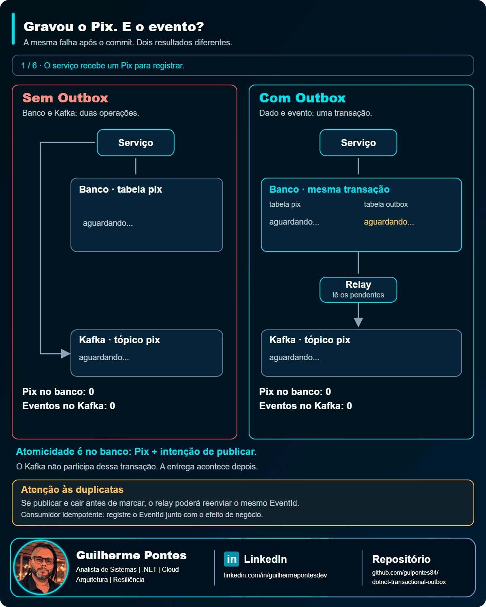

# Transactional Outbox com C# e Kafka

Exemplo didático de **.NET 10 + EF Core + SQLite + Kafka** usando **três registros internos de Pix**: R$ 25,90, R$ 42,00 e R$ 100,00. Não realiza transferências bancárias. Cada Pix recebe um ID e um EventId próprios; os números #001–#003 no GIF são rótulos didáticos.



## O problema

Gravar no banco e depois publicar no Kafka são duas operações independentes. Se a publicação falhar após o commit, o dado fica salvo sem que o evento chegue ao broker. Neste cenário sem Outbox, não há registro durável nem rotina de reenvio.

## A solução

```text
Serviço → Banco [pix + outbox na mesma transação]
                    ↓
              Relay (BackgroundService)
                    ↓ tenta novamente em caso de falha
              Kafka (tópico pix)
```

O endpoint não chama Kafka. Ele adiciona o Pix e a mensagem ao mesmo DbContext e chama `SaveChangesAsync` uma vez. O relay consulta pendências, aguarda o ACK do Kafka e só depois salva `PublishedAtUtc`.

## Executar

Requer SDK .NET 10. Para Kafka real, Docker com engine Linux em execução.

```powershell
docker compose up -d --wait
docker compose exec kafka /opt/kafka/bin/kafka-topics.sh --bootstrap-server localhost:9092 --create --if-not-exists --topic pix --partitions 1 --replication-factor 1
dotnet run --project src/OutboxPixDemo -- --urls http://localhost:5080
```

Em outro terminal PowerShell:

```powershell
./scripts/register-three-pix.ps1
Invoke-RestMethod http://localhost:5080/outbox
docker compose exec kafka /opt/kafka/bin/kafka-console-consumer.sh --bootstrap-server localhost:9092 --topic pix --from-beginning
```

## Reproduzir a falha

1. Pare somente o broker: `docker compose stop kafka`.
2. Em uma base nova, execute `./scripts/register-three-pix.ps1` uma vez. As três respostas são 201: os três Pix e seus eventos estão no SQLite, cada par gravado em sua própria transação.
3. Consulte `/outbox`: os três eventos permanecem com `publishedAtUtc: null`.
4. Inicie o broker: `docker compose start kafka`.
5. O relay tenta novamente, um evento por vez, e preenche `publishedAtUtc` após cada confirmação. Ao final: três Pix no banco e três eventos distintos no Kafka.

O script cria três novos Pix em cada execução. Para repetir a demonstração partindo do zero, use outro arquivo SQLite pela variável `ConnectionStrings__Pix`; não execute o script novamente esperando manter apenas três registros.

A consulta `/outbox` exibe dados internos para facilitar esta demonstração.

## Verificações sem Docker

```powershell
dotnet run --project src/OutboxPixDemo -- --self-test
```

Executa verificações com SQLite real em memória e publisher simulado: rollback dos dois registros, commit conjunto, falha do broker, recuperação, falha após ACK, reenvio com o mesmo EventId e ausência de reenvio após marcação.

## O cuidado com duplicatas

Se Kafka confirmar e o processo cair antes de marcar a linha, o relay publicará de novo. `EnableIdempotence` protege retries do produtor, mas não remove essa janela entre banco e broker. A entrega é **pelo menos uma vez**, não uma garantia de processamento exatamente uma vez.

O consumidor deve deduplicar pelo `EventId`. Para efeitos no mesmo banco do consumidor, grave o ID processado (Inbox com restrição única) e a alteração de negócio na mesma transação; confirme o offset depois do commit. Para efeitos externos, use também uma chave idempotente no destino. Este exemplo implementa produtor e relay; não inclui consumidor.

## Limites do exemplo

- Apenas uma instância ativa do relay. Antes de escalar, implemente claim/lease ou outra estratégia de coordenação.
- Retry fixo de 2 segundos; falhas permanentes bloqueiam a fila. Em produção, defina backoff, alertas e tratamento de mensagens problemáticas.
- `EnsureCreated` facilita a demonstração; produção requer migrations, monitoramento do atraso, retenção e limpeza do Outbox.
- POST sem chave idempotente: duas requisições criam dois registros. A idempotência da API é uma preocupação adicional.
- Kafka local com um broker, sem autenticação, exposto apenas no localhost. Configuração de demonstração.
- Preservar ordem de negócio e dimensionar réplicas do broker exigem decisões adicionais. A chave do evento usa o PixId.

## Referências

- [Transactional Outbox — Chris Richardson](https://microservices.io/patterns/data/transactional-outbox.html)
- [Transações no EF Core](https://learn.microsoft.com/en-us/ef/core/saving/transactions)
- [Cliente .NET do Kafka](https://docs.confluent.io/kafka-clients/dotnet/current/overview.html)

## Material visual

- [GIF para publicação](media/outbox-pix.gif)
- [SVG original](media/outbox-pix.svg)
- [Padrão visual e instruções de exportação](docs/padrao-visual.md)

Validação local: compilação e nove verificações automatizadas com SQLite real e publisher simulado, incluindo os três Pix e seus EventIds distintos. O teste de queda após ACK produz quatro entregas simuladas (três eventos distintos e uma repetição deliberada); o GIF mostra a recuperação sem essa queda adicional e encerra com três eventos. A integração com um broker Kafka real depende de Docker em execução e não foi executada neste ambiente.

## Autor

**Guilherme Pontes** · [LinkedIn](https://www.linkedin.com/in/guilhermepontesdev) · [GitHub](https://github.com/guipontes84)
